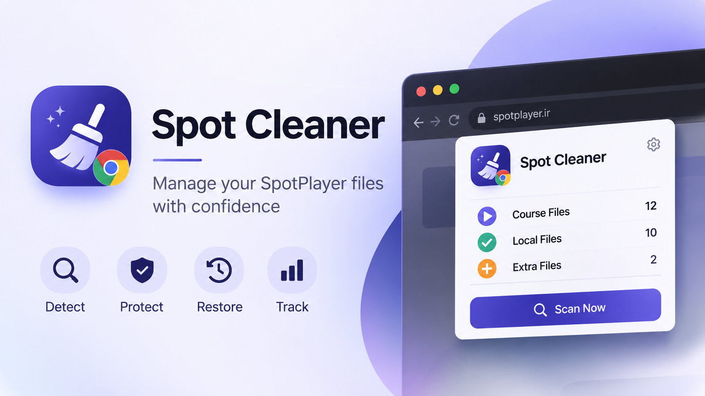

# Spot Cleaner

A Chrome extension (Manifest V3) for comparing SpotPlayer course lessons with locally downloaded `.spot` files and safely quarantining selected extra files.

**Current version:** `0.2.3` · **Status:** Beta / community testing
<p align="center">
  
</p>

[راهنمای فارسی](README_FA.md)

## Features

- Detect a SpotPlayer course and extract its lesson list.
- Extract lesson IDs from `.spot` URLs.
- Scan a user-selected local folder, including subfolders.
- Compare course lessons with local files: matched, missing, and extra.
- Filter results and export a CSV report.
- Select extra files and move them to a user-selected quarantine folder.
- Avoid overwriting files with the same name in the destination.
- Verify copied file size before deleting the source file.
- Store quarantine history in IndexedDB and support restoring files.

## Requirements

- Google Chrome with Manifest V3 support.
- Access to `https://app.spotplayer.ir/`.
- Local folder access through Chrome's File System Access API.

## Install from source

1. Download or clone this repository.
2. Open `chrome://extensions` in Chrome.
3. Enable **Developer mode**.
4. Click **Load unpacked**.
5. Select the repository folder containing `manifest.json`.
6. Open a SpotPlayer course page and open the extension.

## Safety notes

- The extension performs its file operations locally in the browser; it does not upload course lists or local file contents to a project server.
- The user selects the source and quarantine folders and confirms the operation.
- Quarantine is implemented as a copy, size verification, then source deletion. Do not interrupt the browser during a move.
- Existing destination files are not overwritten.
- Quarantine history and directory handles are stored in the browser's IndexedDB. Clearing extension/browser data or revoking folder permissions can affect restoration.
- Keep backups of important files. Test with nonessential files before using the extension on a large collection.


## Project structure

```text
manifest.json
popup.html
popup.css
popup.js
content.js
icons/
fonts/
README.md
README_FA.md
CHANGELOG.md
```

## Disclaimer

Spot Cleaner is an independent community project and is not affiliated with, endorsed by, or supported by SpotPlayer. SpotPlayer is referenced only to describe compatibility.
